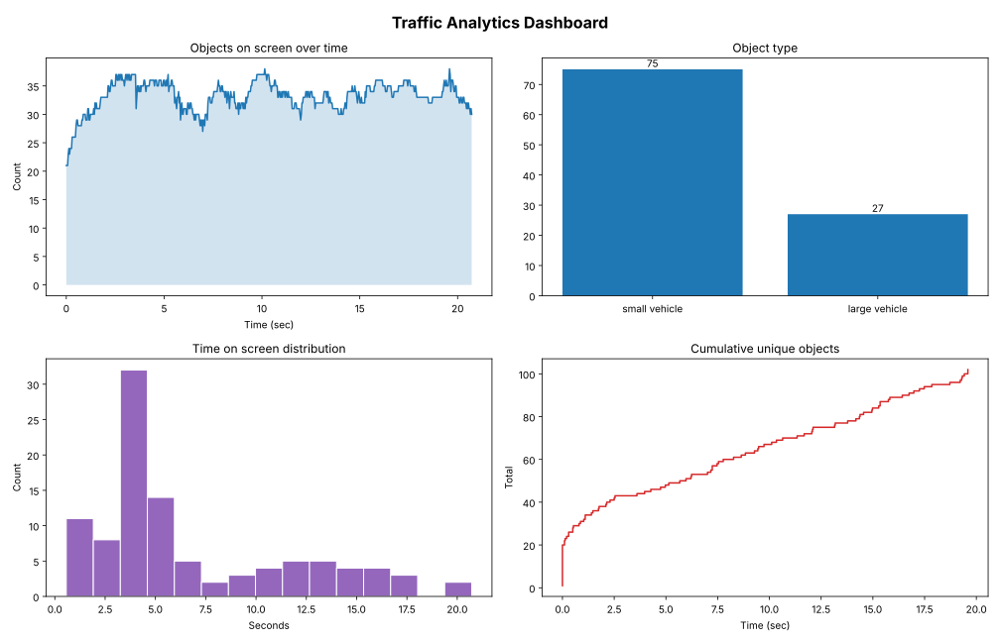

# Traffic Analytics with YOLOv8 & Object Tracking

Turns raw video into traffic metrics: every vehicle (or person) is detected, given a persistent ID, and tracked across frames. The detections are then cleaned and aggregated into a summary table and a 4-panel dashboard.



## What it does

1. **Detect & track**: YOLOv8 detects objects in each frame and the built-in tracker keeps the same ID for the same object across frames.
2. **Log detections**: every detection is saved as a row (frame, time, ID, type, confidence) in `detections.csv`.
3. **Clean**: IDs that appear for less than 0.5 seconds are treated as tracking noise and removed.
4. **Analyze**: per-object time on screen, peak load, vehicle-type mix, and cumulative count.
5. **Visualize**: an annotated video with a live counter, plus a dashboard image.

## Three modes

| Mode | Model | Detects |
|---|---|---|
| `people` | YOLOv8n | Pedestrians |
| `vehicles` | YOLOv8s | Cars, motorcycles, buses, trucks (street-level footage) |
| `aerial` | YOLOv8s-OBB | Small & large vehicles from drone / top-down footage (rotated boxes) |

Street-level models miss most vehicles in drone footage, so the aerial mode uses an oriented-bounding-box model trained on aerial imagery.

## Results (aerial mode, 20.8-second drone clip)

| Metric | Value |
|---|---|
| Detections logged | 20,632 |
| Unique vehicles tracked | 104 raw → **102 after cleaning** (2 noise IDs removed) |
| Vehicle mix | 75 small · 27 large |
| Vehicles on screen | 33.2 on average, peak of 38 at 10.1 sec |
| Avg time on screen | 6.8 sec per vehicle |
| Avg detection confidence | 0.76 |

## Run it

```bash
pip install -r requirements.txt
python traffic_analytics.py --video your_video.mp4 --mode aerial
```

Outputs go to `outputs/`: `tracked_<mode>.mp4`, `detections.csv`, `summary.csv`, `dashboard.png`.

## Tech

Python · Ultralytics YOLOv8 · OpenCV · pandas · matplotlib

## Possible applications

Traffic flow monitoring, parking occupancy, footfall counting in retail and malls, and peak-hour staffing.
